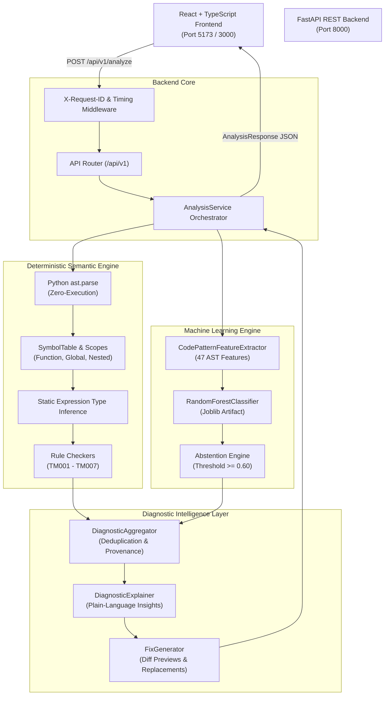
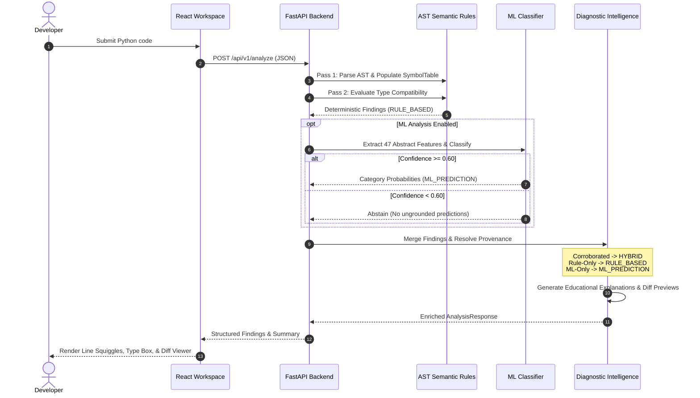

# TypeMind AI
### *Understand Code. Detect Errors. Think Smarter.*

[](https://github.com/viswa/TypeMindAI)
[](https://github.com/viswa/TypeMindAI)
[](https://python.org)
[](https://nodejs.org)
[](https://fastapi.tiangolo.com)
[](https://react.dev)
[](LICENSE)

**TypeMind AI** is a machine-learning-assisted semantic analyzer for intelligent type-error detection in Python source code. It unifies deterministic Abstract Syntax Tree (AST) semantic rules, lexical scoping, probabilistic machine learning classification, educational plain-language explanations, automated fix recommendations with diff previews, a high-performance FastAPI backend, and a modern React + TypeScript frontend workspace.

---

## 1. Problem Statement & Motivation

Python's dynamic typing provides rapid development velocity but introduces runtime failure risks:
- Runtime `TypeError` exceptions account for a substantial percentage of uncaught Python errors in production.
- Existing static analyzers (e.g. MyPy, Pyright) require extensive manual type annotations and rigid configurations that many codebases lack.
- Traditional linting tools produce dry, cryptic error codes without explaining *why* Python behaves that way or providing automated fix replacements.
- Standalone Large Language Models (LLMs) frequently hallucinate non-existent types or suggest breaking changes.

**TypeMind AI bridges this gap** by:
1. Performing **zero-execution static AST analysis** that deterministically flags confirmed type mismatches even without complete annotations.
2. Employing a **reproducible machine learning classifier** (Random Forest with confidence-based abstention) to corroborate patterns and assess error likelihood.
3. Enforcing a **strict domain contract**: statistical ML predictions are never marked as confirmed errors unless backed by deterministic rule verification.
4. Providing **contextual explanations and interactive before-and-after diffs** directly in a web-based code editor.

---

## 2. System Architecture

TypeMind AI is designed as a decoupled, multi-tiered architecture separating semantic inference, machine learning, API delivery, and presentation:



---

## 3. Data Flow & Provenance Model

Every diagnostic finding is assigned an explicit **Provenance**:



### Provenance Guarantee

| Provenance | Type | Confirmation (`is_confirmed`) | Source |
| :--- | :--- | :--- | :--- |
| `RULE_BASED` | Deterministic | `True` | Verified by AST analysis, symbol resolution, and type checking rules. |
| `HYBRID` | Corroborated | `True` | Detected via static rule and confirmed by ML classification probability. |
| `ML_PREDICTION` | Probabilistic | `False` | Statistical prediction. Schema validation strictly forbids marking as confirmed without rule evidence. |

---

## 4. Supported Semantic Checks

| Rule ID | Category | Severity | Description | Fix Support |
| :--- | :--- | :--- | :--- | :--- |
| **`TM000_SYNTAX_ERROR`** | `syntax_error` | `ERROR` | Python grammar failure parsed with line/column coordinates. Halted parsing reported cleanly. | Coordinate pointer |
| **`TM001_STRING_NUMBER_CONCAT`** | `type_mismatch` | `ERROR` | Binary `+` between `str` and numeric types (`int`, `float`, `bool`). | `str(...)` wrap suggestion |
| **`TM002_UNSUPPORTED_ARITHMETIC`** | `unsupported_operand` | `ERROR` | Incompatible operations: `str - str`, `str * str`, `None + num`, `list + tuple`, `list - list`, `{set} + {set}`. | Contextual explanation |
| **`TM003_ARGUMENT_COUNT_MISMATCH`** | `argument_count_mismatch` | `ERROR` | Function calls with missing required arguments or excessive positional arguments (respects defaults and `*args`/`**kwargs`). | Parameter signature |
| **`TM004_ARGUMENT_TYPE_MISMATCH`** | `argument_type_mismatch` | `ERROR` | Argument passed to function is incompatible with declared parameter annotation. | Expected vs observed type |
| **`TM005_INCOMPATIBLE_RETURN`** | `incompatible_return` | `ERROR` | Function return expression does not match declared return type annotation (permits numeric widening `int -> float`). | Type cast / signature fix |
| **`TM006_INVALID_ANNOTATED_ASSIGNMENT`** | `invalid_assignment` | `ERROR` | Assigning an expression of incompatible type to a variable with an explicit type annotation (`x: int = "hello"`). | Annotation update |
| **`TM007_INCOMPATIBLE_REASSIGNMENT`** | `invalid_assignment` | `WARNING` | Reassigning a variable in the same scope from established type `T1` to incompatible type `T2`. | Consistency advisory |

---

## 5. Technology Stack

- **Backend**:
  - Python **3.11 / 3.12 / 3.13**
  - **FastAPI** (v0.115+) & **Uvicorn** (ASGI server)
  - **Pydantic v2** (`pydantic-settings`) for data contracts
  - **scikit-learn** (v1.5+), **Joblib**, **NumPy**, **Pandas** for ML pipeline
  - **Pytest** & **HTTPX** for test automation
- **Frontend**:
  - **React 19** & **TypeScript 5.7+**
  - **Vite 6** build tool & dev server
  - **Vanilla CSS** with curated CSS Custom Properties (Dark theme, cyan/violet accents)
  - **Lucide React** for accessible iconography
  - **Vitest** & **React Testing Library** for frontend testing
- **Deployment & Containers**:
  - **Docker** multi-stage builds
  - **Docker Compose**
  - **Nginx** Alpine reverse proxy

---

## 6. Installation & Quick Start

### Prerequisites
- **Python**: 3.11, 3.12, or 3.13
- **Node.js**: >= 20.0.0 (v24 LTS tested)
- **Git**

### Step 1: Clone Repository
```bash
git clone https://github.com/viswa/TypeMindAI.git
cd TypeMindAI
```

### Step 2: Setup Python Virtual Environment
- **Windows (PowerShell):**
  ```powershell
  python -m venv .venv
  .\.venv\Scripts\Activate.ps1
  pip install -r backend/requirements.txt
  ```
- **Linux / macOS:**
  ```bash
  python3 -m venv .venv
  source .venv/bin/activate
  pip install -r backend/requirements.txt
  ```

### Step 3: Setup Frontend Dependencies
```bash
cd frontend
npm install
cd ..
```

### Step 4: Configure Environment Files
- **Backend configuration:**
  ```bash
  cp backend/.env.example backend/.env
  ```
- **Frontend configuration:**
  ```bash
  cp frontend/.env.example frontend/.env
  ```

---

## 7. Running the Application

### Option A: Unified Full-Stack Launcher (Recommended)
Launch both backend (`http://127.0.0.1:8000`) and frontend (`http://127.0.0.1:5173`) with a single command:

```powershell
python scripts/dev.py full
```

### Option B: Running Services Individually

1. **Launch FastAPI Backend:**
   ```powershell
   python -m uvicorn app.main:app --app-dir backend --host 127.0.0.1 --port 8000 --reload
   ```
   - API Base: `http://127.0.0.1:8000`
   - Interactive Swagger Docs: `http://127.0.0.1:8000/docs`
   - ReDoc: `http://127.0.0.1:8000/redoc`

2. **Launch React Frontend:**
   ```bash
   cd frontend
   npm run dev
   ```
   - Web Workspace: `http://127.0.0.1:5173`

---

## 8. REST API Reference

All endpoints return JSON and enforce strict schema boundaries.

### `POST /api/v1/analyze`
Analyze submitted Python source code.
- **Request Headers:** `Content-Type: application/json`, `X-Request-ID` *(optional)*
- **Request Body:**
  ```json
  {
    "source_code": "def greet(name: str) -> str:\n    return name + 42\n",
    "file_path": "example.py",
    "enable_ml_analysis": true,
    "min_confidence": 0.60
  }
  ```
- **Response (200 OK):**
  ```json
  {
    "status": "success",
    "syntax_error": null,
    "findings": [
      {
        "id": "TM001-94f624a4",
        "message": "Cannot concatenate 'str' and 'int' using the '+' operator.",
        "category": "type_mismatch",
        "severity": "error",
        "location": { "file_path": "example.py", "line": 2, "column": 12, "end_line": 2, "end_column": 21 },
        "origin": "hybrid",
        "is_confirmed": true,
        "expected_type": { "raw_type": "str" },
        "observed_type": { "raw_type": "int" },
        "rule_id": "TM001_STRING_NUMBER_CONCAT",
        "suggested_fixes": [
          {
            "id": "fix-concat-9adb001c",
            "title": "Convert int operand to str",
            "description": "Wrap expression with str() to allow string concatenation.",
            "replacements": [
              {
                "location": { "file_path": "example.py", "line": 2, "column": 19, "end_line": 2, "end_column": 21 },
                "new_text": "str(42)",
                "description": "Convert operand to string"
              }
            ],
            "diff_preview": "- 42\n+ str(42)",
            "confidence": 0.98,
            "is_auto_applicable": true
          }
        ],
        "explanation": "In Python, the '+' operator does not automatically convert numbers to strings. Use explicit str() conversion or f-strings instead."
      }
    ],
    "summary": {
      "total_findings": 1,
      "rule_based_findings": 1,
      "ml_predicted_findings": 1,
      "errors_count": 1,
      "warnings_count": 0,
      "syntax_errors_count": 0,
      "category_counts": { "type_mismatch": 1 },
      "severity_counts": { "error": 1 },
      "execution_time_ms": 1.45,
      "lines_analyzed": 2
    },
    "server_version": "0.1.0"
  }
  ```

### `GET /health` & `GET /api/v1/health`
Returns operational health status, version, and deployment environment.

### `GET /api/v1/info`
Returns project metadata, API version, and supported Python grammar version.

### `GET /api/v1/diagnostics/categories`
Returns catalog of registered diagnostic categories, default severities, rule IDs, and fix capabilities.

### `GET /api/v1/model/info`
Returns ML model architecture (`RandomForestClassifier`), classes, feature counts, and held-out evaluation summary. Gracefully returns `{"status": "unavailable"}` if model weights are missing without 500 errors.

---

## 9. Machine Learning Pipeline & Dataset

### Dataset Construction & Provenance
The initial training dataset ([`datasets/type_patterns_dataset.json`](file:///c:/Users/viswa/Desktop/TypeMindAI/datasets/type_patterns_dataset.json)) comprises **42 curated Python code snippets**:
- **Origin**: Synthetic benchmarks constructed across 7 canonical classes (`type_mismatch`, `incompatible_return`, `argument_count_mismatch`, `argument_type_mismatch`, `unsupported_operand`, `invalid_assignment`, and `no_error`).
- **Diversity**: Varies identifier names, function scopes, expression depths, and return types.
- **Deduplication**: Strict deduplication ensures train and test splits do not share near-duplicate AST structures.
- **Synthetic Disclosure**: Clearly documented as synthetic; designed for pattern verification rather than claiming general real-world coverage.

### Model Architecture & Features
- **Vectorization**: `DictVectorizer` transforming 47 AST structural and type-inference features (e.g. `node_type`, `operator`, `is_in_function`, `has_defaults`, `left_type`, `right_type`).
- **Classifier**: `RandomForestClassifier(n_estimators=100, max_depth=12, random_state=42)` selected over LogisticRegression.
- **Evaluation Report**: Complete benchmark details and confusion matrix documented in [`docs/ml_evaluation_report.md`](file:///c:/Users/viswa/Desktop/TypeMindAI/docs/ml_evaluation_report.md).

### Retraining the Model
Execute the standalone ML training pipeline:

```powershell
python scripts/train_ml.py
```

The script will evaluate cross-validation splits, train the model, persist serialized weights to `backend/app/ml/artifacts/type_classifier.joblib`, and write `model_metadata.json`.

---

## 10. Automated Testing Suite

TypeMind AI maintains high test coverage across both backend and frontend layers:

### Run All Tests via Dev Script
```powershell
python scripts/dev.py test
```

### Backend Tests (127 Pytest Tests)
```powershell
pytest backend/tests -v
```
Covers: AST visitor logic, symbol tables, lexical scopes, union types, rule checks, ML featurizer determinism, predictor abstention, error handlers, and REST API integration tests.

### Frontend Tests (10 Vitest Tests)
```bash
cd frontend
npm test
```
Covers: Component rendering, code editor keyboard shortcuts (`Ctrl+Enter`, `Tab`), line numbers gutter, diagnostic findings, type boxes, diff viewers, and API integration mocking.

### Live Server Verification
```powershell
python scripts/verify_server.py
```
Spawns a live Uvicorn instance, probes all 5 endpoints, tests live AST and ML inference, and validates `X-Request-ID` tracing.

---

## 11. Production Deployment (Docker)

TypeMind AI is ready for containerized deployment using Docker and Docker Compose.

### Quick Start with Docker Compose
```bash
docker-compose up --build
```
- **Frontend Workspace**: Accessible at `http://localhost:3000`
- **Backend REST API**: Accessible at `http://localhost:8000`
- **Health Check**: Automatically monitors `http://backend:8000/health` before starting frontend.

### Environment Variables
| Variable | Default | Purpose |
| :--- | :--- | :--- |
| `ENVIRONMENT` | `development` | Deployment mode (`development`, `production`, `test`) |
| `DEBUG` | `true` | FastAPI debug mode |
| `LOG_LEVEL` | `INFO` | Logging level (`DEBUG`, `INFO`, `WARNING`, `ERROR`) |
| `CORS_ORIGINS` | `["http://localhost:3000","http://localhost:5173"]` | Allowed frontend origins |
| `ML_MODEL_PATH` | `app/ml/artifacts/type_classifier.joblib` | Path to serialized ML artifact |
| `MIN_CONFIDENCE_THRESHOLD` | `0.60` | Minimum confidence required before reporting ML prediction |
| `MAX_SOURCE_SIZE_BYTES` | `500000` | Maximum allowed source code payload (500 KB limit) |
| `VITE_API_BASE_URL` | `http://127.0.0.1:8000` | Backend API URL for frontend client |

---

## 12. Security & Safety Engineering

1. **Zero Code Execution**: Code analysis operates purely over the AST via `ast.parse` and `ast.NodeVisitor`. User code is never imported, compiled into bytecode, executed, or passed to `eval()`.
2. **Payload Protection**: Source code size is enforced at both client and server boundaries (`500 KB` limit). Empty inputs and oversized payloads are rejected with HTTP 422.
3. **Privacy-Preserving Logs**: User source code is never printed in server logs. Only line counts, character lengths, request IDs, and response latencies are recorded.
4. **XSS Protection**: Code snippets, identifiers, and diagnostic messages are treated as untrusted text and safely escaped by React and Nginx security headers (`X-Content-Type-Options: nosniff`, `X-Frame-Options: DENY`).
5. **Graceful Model Degradation**: Missing or corrupted ML model weights never crash the API or halt analysis. Rule-based static checks continue running normally with `status: "unavailable"` returned on model info endpoints.

---

## 13. Limitations & Future Roadmap

While TypeMind AI accurately catches common static type errors without execution, researchers and developers should note current limitations:
- **Control Flow Path Narrowing**: Branch-dependent type narrowing (e.g., `if isinstance(x, str): ...`) is currently handled conservatively; full control-flow graph (CFG) analysis is planned for future work.
- **Dynamic Metaprogramming**: Dynamic Python features like `eval()`, `exec()`, `__getattr__`, or dynamic monkey-patching cannot be analyzed statically.
- **Third-Party Type Stubs**: Functions from unannotated external packages without type stubs default to `Unknown` to avoid false positives.
- **Synthetic ML Dataset**: The current ML model is trained on a synthetic dataset designed for structural pattern validation. Expanding to mined GitHub open-source repositories is planned.

---

## 14. License

This project is licensed under the MIT License — see the [LICENSE](LICENSE) file for details.
