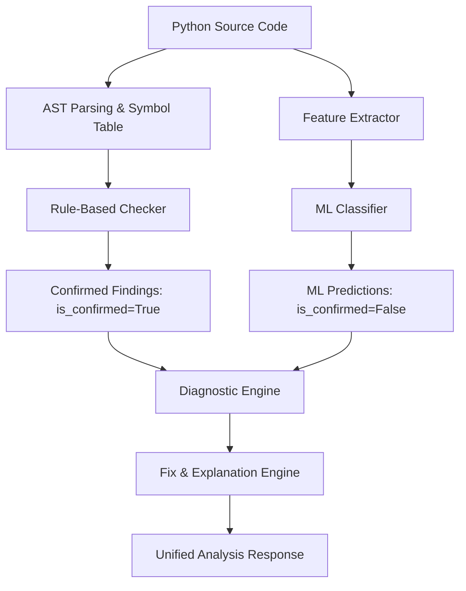

# TypeMind AI - Architecture Specification

## 1. System Overview
**TypeMind AI** is a machine-learning-assisted semantic analyzer for intelligent type-error detection in Python source code. It combines:
1. **Deterministic AST-based semantic analysis**: High-precision static rule checks.
2. **Machine Learning Classifier**: Statistical heuristics to detect subtle type patterns, rank fixes, and surface anomalies that purely static rules miss.
3. **Diagnostic & Explanation Engine**: Actionable explanations, exact source locations, and code fix suggestions.
4. **FastAPI Backend**: High-performance asynchronous REST API.
5. **React + TypeScript Frontend**: Interactive modern developer experience (subsequent phase).

---

## 2. Monorepo Structure

```text
typemind-ai/
├── backend/
│   ├── app/
│   │   ├── api/             # Versioned REST API endpoints (v1)
│   │   ├── core/            # Configuration, logging, exception handling
│   │   ├── models/          # Domain data models
│   │   ├── schemas/         # Pydantic v2 validation contracts
│   │   ├── services/        # Orchestration and business logic
│   │   ├── semantic/        # AST parsing and deterministic type checkers
│   │   ├── ml/              # Model loaders, feature extractors, classifiers
│   │   ├── diagnostics/     # Unified diagnostic generator and fix engine
│   │   ├── utils/           # Helper utilities
│   │   └── main.py          # FastAPI application factory and ASGI entrypoint
│   ├── tests/               # Pytest suite
│   ├── requirements.txt     # Python dependencies
│   └── .env.example         # Template configuration
├── frontend/                # React + TypeScript web client
├── datasets/
│   └── samples/             # Curated Python code snippets for testing & training
├── scripts/                 # Development and automation scripts
├── docs/                    # Architecture and API documentation
├── .gitignore
└── README.md
```

---

## 3. Data Contracts & Safeguards

### Distinguishing Rule-Based vs. ML Predictions
A core architectural principle of TypeMind AI is the strict separation between:
- **`RULE_BASED`**: Confirmed findings derived from deterministic Abstract Syntax Tree (AST) inspection, scope analysis, and type signature verification. High confidence, zero false-positive tolerance. Marked with `is_confirmed = True`.
- **`ML_PREDICTION`**: Probabilistic findings output by trained machine learning models. Each includes confidence scores (`0.0` - `1.0`), model metadata, and feature attribution. Marked with `is_confirmed = False` unless corroborated by deterministic rules.
- **`HYBRID`**: Candidates originating from rule heuristics and enriched/ranked by machine learning models.



---

## 4. Engineering Safeguards & Reliability
- **Pydantic v2 Validation**: All inputs and outputs are validated at runtime with strict constraints.
- **Centralized Settings**: Structured configuration via `pydantic-settings` with type safety and environment variable overrides.
- **Structured Logging**: Unified logging formatting with contextual request metadata.
- **Standardized Error Handling**: Unhandled exceptions are intercepted by FastAPI exception handlers and transformed into RFC 7807 compliant problem details.
- **Isolated Testing**: Tests use `FastAPI.testclient` and mock fixtures without external network dependencies.
